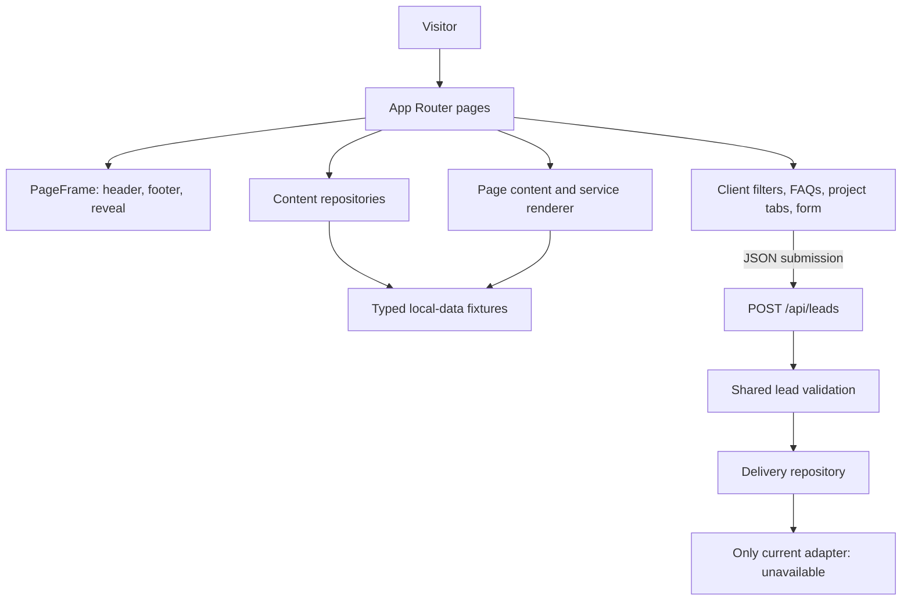

# Project Context

Repository analysis dated **12 November 2026**, based on checkout `33638c1` (`Update TNT website implementation`). This document describes the implementation in this checkout; existing briefs are requirements and historical context, not proof of current behavior.

**Evidence labels:** **VERIFIED** means established from repository files or the checks described below. **INFERENCE** means an architectural implication that has not been measured in a running application. **UNKNOWN** means the evidence is absent or the behavior was not exercised. Recommendations describe future work, not changes made during this review.

## 1. Project Overview

**VERIFIED:** This is a Vietnamese corporate and lead-generation website for TNT / Trí Nghĩa Tech. It presents TNM ERP, custom software development / Outsourcing, IT staffing / Body Shop, manufacturing projects, articles, resources, and FAQs. The food-processing solution has a dedicated landing page.

The repository implements the marketing website, not the ERP, recruitment, e-learning, or other customer systems described in its copy. Content is hard-coded. There is no implemented database, CMS, administration interface, user-account system, or working lead-delivery integration.

There are **14 page templates**: 12 fixed routes and two slug-based detail templates. Current fixtures provide four project detail URLs and six article detail URLs, yielding 22 concrete page URLs. Metadata routes and the lead endpoint are additional routes.

Much of the content is explicitly illustrative or awaiting company approval. Company claims, people, customer work, metrics, imagery rights, contact information, and actual release approval are **UNKNOWN**; their appearance in source does not verify them.

## 2. Project Type and Technology Stack

| Technology | Repository evidence and role |
|---|---|
| Next.js **16.4.6** | `package.json`, `src/app/`; App Router, server components, route handler, metadata, image optimization, navigation. |
| React / React DOM **19.3.0** | Page composition and interactive client components. |
| TypeScript | Strict configuration in `tsconfig.json`; installed version **5.9.3**, declared range `^5`. |
| Tailwind CSS **4.3.3** | Imported by `src/app/globals.css`; processed through `@tailwindcss/turbopack` **4.3.3**. Most visual styling is custom global CSS. |
| Iconsax React **0.0.8** | Shared typed icon map in `src/components/ui/icon.tsx`, consistently using the Linear variant. |
| ESLint | Installed **9.39.5**, declared `^9`; Next core-web-vitals and TypeScript presets in `eslint.config.mjs`. |
| npm | `package-lock.json` lockfile version 3; no alternative package-manager lockfile. |

Application languages are TypeScript/TSX and CSS, with JSON configuration/data metadata, Markdown documentation, SVGs, WebP images, and a favicon. No other application language or separate backend project was found.

## 3. Development Environment and Setup Requirements

**VERIFIED:** Installed Next.js requires Node.js **>=20.9.0**. The review environment had Node.js **24.16.0**, npm **11.13.0**, and existing `node_modules/`. There is no committed Node version file or package-manager version pin.

Run from the repository root:

| Command | Purpose |
|---|---|
| `npm run dev` | Starts `next dev`; normally serves the local site at `http://localhost:3000`. |
| `npm run build` | Runs `next build` to produce a production build. |
| `npm start` | Runs `next start`; requires a successful build first. |
| `npm run lint` | Runs `eslint src`; does not lint the entire repository. |
| `node node_modules/typescript/bin/tsc --noEmit --incremental false` | Checks types without emitting JavaScript or TypeScript build-info files. |

On this Windows PowerShell environment, bare `npm` resolves to an execution-policy-blocked `npm.ps1`; `npm.cmd` works. For a future fresh setup, restore locked dependencies with `npm ci` when installation is authorized. **No dependencies were installed during this review.**

Only two application environment variables are referenced:

- `NEXT_PUBLIC_SITE_URL`: canonical origin used by `src/app/layout.tsx`, `src/app/sitemap.ts`, and `src/app/robots.ts`; falls back to `http://localhost:3000`.
- `LEAD_PROVIDER`: read only by `src/server/leads/delivery.ts`; absent/blank becomes `none`. No functioning provider is implemented.

No `.env.example` or `.env.local` exists in this checkout. The README's template-copy step cannot work as written. Real deployment environment values are **UNKNOWN**. Keep provider credentials server-side; `.gitignore` excludes `.env*` and PEM files.

**Agent constraint:** Read `AGENTS.md` before development. It requires consulting the relevant installed guides in `node_modules/next/dist/docs/` before writing code for this Next.js version. Local route-handler, server/client-component, and dynamic-route guides were consulted during this analysis. `next dev` can regenerate the agent-instruction block; do not remove it casually. `next-env.d.ts` is generated and currently references `.next/dev/types/`; do not edit it manually.

## 4. Repository Structure

```text
src/
  app/                    Route pages, layout, metadata routes, global styles
    api/leads/route.ts    The sole application JSON endpoint
    dich-vu/              Services overview and three service pages
    du-an/                Projects listing and [slug] detail
    giai-phap-nganh-thuc-pham/  Food-processing landing page
    kien-thuc/            Knowledge, blog/[slug], guides, FAQ
    ve-tnt/               About page
  components/             Shared shells, interactive browsers/forms, service renderer
    ui/icon.tsx           Iconsax abstraction
  content/                Models, local fixture data, repository adapters
    reference-assets/     Reference images and provenance manifest
  lib/                    Metadata and article-anchor helpers
  server/leads/           Submission contract, validation, delivery boundary
public/
  images/                 Images actively referenced by application source
  demo/                   Copies of prototype/reference imagery
docs/                     Product brief, deadlines, historical reviews, visual prompt
```

Important root files are `package.json`, `package-lock.json`, `tsconfig.json`, `next.config.ts`, `eslint.config.mjs`, `.gitignore`, `AGENTS.md`, and `README.md`.

Two unusually named tracked root files, `ite_project add -A` and `ite_project push origin do-hong-minh`, contain captured Git diff/pager-help output. They are not application entry points or scripts.

Generated `.next/`, dependencies in `node_modules/`, and Git internals were excluded from deep application review. Installed package manifests and relevant framework guides were inspected selectively. No test directory, CI workflow, Dockerfile, database migration, or deployment configuration was found.

## 5. Architecture Overview

**VERIFIED:** One Next.js application combines server-rendered presentation, local content access, browser interaction, and a small server endpoint. Its principal separation is routes → shared components → typed content/repositories, with a separate lead-delivery boundary.



- `src/app/layout.tsx` supplies the Vietnamese HTML root, global stylesheet, font variables, and site metadata. It does **not** include navigation itself.
- Each page composes `PageFrame` from `src/components/site-shell.tsx`, or uses `ContentPageShell`, which includes `PageFrame` internally.
- Pages are server components. Six components explicitly declare `"use client"`: `site-header`, `catalog-browser`, `faq-browser`, `home-project-showcase`, `lead-form`, and `scroll-reveal`.
- Server pages pass serializable catalog/FAQ records into browser components. Filtering and selection use local React state; there is no global state library or content-fetching API.
- The repository abstraction is asynchronous despite reading in-memory arrays, providing a possible seam for a future content backend. The seam is incomplete: Home, About, Food, `ServiceLanding`, and the client-side project showcase import fixtures directly.

**INFERENCE:** These direct imports increase migration work and can bring fixture data into client dependency graphs. Actual shipped bundle size and tree-shaking behavior are **UNKNOWN**.

## 6. Main Components and Modules

| Area | Implementation and responsibility |
|---|---|
| Home `/` | `src/app/page.tsx`: hero, company statistics, five service tiles, ERP module panel, reasons, process, project showcase, insight teasers, lead form. |
| About `/ve-tnt` | `src/app/ve-tnt/page.tsx`: company overview, capabilities, Connect/Fit/Deliver method, metrics, leadership examples, contact form. |
| Food solution | `src/app/giai-phap-nganh-thuc-pham/page.tsx`: challenges, six-stage illustrative workflow, fit categories, project reference, five-step implementation story, FAQs, two forms with distinct IDs. |
| Services overview | `src/app/dich-vu/page.tsx`: approved service records, preview project highlights, cooperation process, general form. |
| Service details | `src/app/dich-vu/{erp,outsourcing,body-shop}/page.tsx`: fetch an approved service or call `notFound()`, then render `src/components/service-landing.tsx`. |
| Service section engine | `service-landing.tsx`: renders discriminated `cards`, `flow`, `steps`, `image-callout`, `projects`, and `faqs` sections from `serviceLandingContent`, then a contextual form. |
| Projects | `src/app/du-an/page.tsx` and `src/app/du-an/[slug]/page.tsx`: featured project, searchable catalog, challenge/solution/outcome, scope, optional gallery, related projects, contact CTA. |
| Knowledge | `src/app/kien-thuc/page.tsx`: articles, topic navigation, recent articles, guide highlights. Featured and recent articles both use the first three array records. |
| Blog and articles | `src/app/kien-thuc/blog/page.tsx` and `src/app/kien-thuc/blog/[slug]/page.tsx`: featured/listed articles, body sections, generated table of contents, related reading, optional service CTA. |
| Guides | `src/app/kien-thuc/guides/page.tsx`: searchable resource cards linking to inline preview anchors; no real PDF downloads. |
| FAQ | `src/app/kien-thuc/faq/page.tsx`, `src/components/faq-browser.tsx`: question/answer search, topic filtering, native `<details>` accordions. |
| Navigation | `site-header.tsx`: active-route detection, desktop dropdowns, mobile menu, Escape/outside-click closing, arrow navigation, search-focus link. VI is an indicator; no language switch exists. |
| Catalog browsing | `catalog-browser.tsx`: title/summary/topic/industry substring search, topic filter, project-only industry filter, counts/reset/empty states. Filtering is case-insensitive using Vietnamese locale, but does not strip accents. |
| Project tabs | `home-project-showcase.tsx`: imports project fixtures, selects by slug, updates image/copy/detail link. |
| Motion | `scroll-reveal.tsx`: IntersectionObserver reveals immediate `main > section` children once, disconnects on cleanup, skips reduced motion or unsupported browsers. |
| Shared presentation | `content-page.tsx`: `EditorialHero`, `ContentPageShell`; also exports `CatalogPage` and `LinkCards`, with no callers found in this checkout. |
| Utilities | `src/lib/metadata.ts`: canonical/Open Graph metadata; `src/lib/anchor-id.ts`: accent normalization and ASCII anchor generation. |

`src/app/globals.css` contains the visual system: 6,004 lines, 930 parsed rules, navy/blue tokens, forms, editorial layouts, responsive grids, focus styles, and motion. The current container cap is **1,230px** with 42px desktop side gutters; mobile navigation begins at **1,120px**. Blog cards use two desktop columns and one column at widths <=760px. Later CSS overrides matter when changing layouts.

## 7. Data Architecture and Database Design

**VERIFIED:** There is no database, ORM, persistence layer, schema migration, object storage integration, or browser storage use in application source. Content lives in `src/content/local-data.ts`, shaped by `src/content/models.ts`.

| Collection | Records | Approved | Identity and relationships |
|---|---:|---:|---|
| Services | 3 | 3 | `slug`, service `href`; connects to `serviceLandingContent[slug]`. |
| Projects | 4 | 0 | `slug`; `relatedProjectSlugs`; optional gallery and customer/scope information. |
| Articles | 6 | 0 | `slug`; `relatedArticleSlugs`; ordered sections/paragraphs and optional service link. |
| Guides | 4 | 0 | `slug`; `fileUrl` is currently `#guide-{slug}`; preview bullet list. |
| FAQs | 8 | 0 | `id`, question/answer, topic, status. Separate food/service FAQ arrays also exist. |

All 22 non-service records above have `status: "pending-review"`. Shared content topics are `ERP`, `Sản xuất`, `Outsourcing`, `Body Shop`, and `Khác`. Base records carry title, summary, status, and optional image/source label. Page-specific Home/About/Food objects are separately typed and do not use the same record-level publication status.

`src/content/repositories.ts` implements:

- `listPublished()` / `findPublishedBySlug()` restrict to `approved`.
- `listForPreview()` / `findForPreviewBySlug()` include every record, without authentication or an environment gate.
- FAQ has list-only methods; the generic repository checks for a `slug` property when looking up records.
- Missing slug lookups return `null`; page callers handle this through `notFound()`.

Uniqueness, relationships, and fixture shape are not validated at runtime. TypeScript checks structure; the review's separate in-memory checks established that current IDs are unique and current related-record references resolve. Source edits are the only content create/update/delete mechanism. There are no content CRUD endpoints.

## 8. Application Execution Flows

### Page rendering and browsing

1. A pathname selects an App Router page beneath `src/app/`.
2. Root layout applies fonts, global CSS, metadata base, and `lang="vi"`.
3. The page loads local fixtures directly or awaits repository methods, composes the shell and page-specific sections, and sends records to interactive components.
4. Browser hydration activates navigation, search/filter state, tabs, reveal effects, and forms. Catalog filters do not call the server, paginate, or persist into the URL.

The header search link navigates to `/kien-thuc/blog?focus=search`; `CatalogBrowser` reads that flag and focuses the search input. It does not populate a query or perform a site-wide search. Knowledge topic links all navigate to the unfiltered blog listing.

### Slug detail pages

Both detail pages await `params: Promise<{ slug: string }>`, look up the record using preview methods, and call `notFound()` if absent. `generateMetadata()` performs its own lookup for title/description/canonical information. Articles generate anchors from headings; projects select related records from the full preview collection.

No `generateStaticParams`, explicit revalidation policy, or external content cache is implemented. Actual production prerendering/build output is **UNKNOWN** because a build was not run.

### Lead submission

1. `src/components/lead-form.tsx` uses native required controls, consent, `FormData`, and page/context props to construct a `LeadSubmission`.
2. It disables the fieldset while submitting and sends JSON via `fetch("/api/leads")`.
3. `src/app/api/leads/route.ts` checks content type, parses JSON, then calls `validateLeadSubmission()`.
4. Valid data is passed to the selected `LeadDeliveryRepository`.
5. The only adapter throws `LeadDeliveryUnavailableError`; the endpoint returns 503. Data is neither saved nor sent by application code.
6. The browser displays errors and server field messages; it resets the form only on an HTTP-success response. The intended 202 success path is unreachable with current adapters.

There are no queue workers, scheduled jobs, cron tasks, webhooks, or background delivery retries. Asynchronous work consists of promise-shaped content reads, form requests, font/build behavior supplied by Next.js, and browser event/observer callbacks.

## 9. API and External Integrations

The sole application API is **`POST /api/leads`**, implemented with standard Web `Request` / `Response.json` APIs. Body fields:

| Field | Server contract |
|---|---|
| `name` | Required trimmed string, max 120 characters. |
| `emailOrPhone` | Required, max 254; email regex or phone regex with 7–25 total characters. Phone validation is permissive, not country-specific verification. |
| `company`, `interest` | Required trimmed strings, max 160 each. `interest` is not restricted to form options. |
| `industry`, `companySize`, `message` | Optional strings; max 160 / 80 / 4,000. Missing/non-string values normalize to empty strings. |
| `consent` | Must equal boolean `true`. |
| `context` | One of `general`, `food-processing`, `erp`, `outsourcing`, `body-shop`. |
| `source` | Required string, max 300, must start with `/`; this is client-supplied attribution. |
| `details` | Allowed keys: `erpNeed`, `projectType`, `estimatedTiming`, `role`, `headcount`, `foodPriority`; supplied values must be strings of at most 160 trimmed characters. |

Responses are JSON:

| HTTP status | Response |
|---|---|
| 415 | `{ error: { code: "UNSUPPORTED_MEDIA_TYPE", message } }` |
| 400 | `{ error: { code: "INVALID_JSON", message } }` for malformed JSON. |
| 400 | `{ error: { code: "VALIDATION_FAILED", message, fields } }` for invalid fields. |
| 503 | `{ error: { code: "LEAD_DELIVERY_UNAVAILABLE", message } }` for the current adapter. |
| 202 | `{ accepted: true }` only after a future adapter resolves successfully. |

Unknown provider names and unexpected delivery errors are thrown rather than mapped to this JSON error contract. The exact framework HTTP response for those exceptions was not exercised and is **UNKNOWN**.

No CRM, email provider, payment service, analytics SDK, remote content API, or authentication provider is wired in. `next/font/google` loads Geist and Geist Mono through Next.js; font acquisition during a clean build may require network access. Images are local and rendered through `next/image`; no remote image configuration is present. Sitemap and robots are generated at `/sitemap.xml` and `/robots.txt`.

## 10. Dependencies and Configuration

- `next.config.ts`: `allowedDevOrigins: ["127.0.0.1"]`; Turbopack applies `@tailwindcss/turbopack` to `*.css`. No custom redirects, response security headers, remote image hosts, or deployment output mode are configured.
- `tsconfig.json`: strict checking, ES2017 target, bundler module resolution, React JSX, `@/*` → `./src/*`, generated Next types, `noEmit`, incremental checking by default. It also excludes `TNT_website_project`; no such nested directory exists here.
- `eslint.config.mjs`: Next core-web-vitals and TypeScript rules; generated/output/dependency paths ignored. No formatter configuration was found.
- `package-lock.json`: 433 package entries including the root. Installed direct versions were checked, but dependency source code and advisory databases were not audited.
- `.gitignore`: excludes dependencies, build/test outputs, environment files, deployment metadata, and TypeScript-generated files.

Production hosting, TLS termination, network protections, logging, monitoring, backup policy, and secret management are **UNKNOWN**. No repository automation establishes them.

## 11. Important Business Logic

1. **Publication filtering is explicit at each call site.** Service pages use approved records. Project/article/guide/FAQ public pages deliberately use preview reads. A `pending-review` flag does not prevent public rendering.
2. **Delivery acceptance determines lead success.** The current `none` adapter never accepts, sends, or stores leads. Choosing another environment value alone cannot enable delivery; an implementation is required.
3. **Lead context varies by page.** General forms use contact/company/interest and optional industry, size, message. ERP adds `erpNeed`; Outsourcing adds `projectType` and `estimatedTiming`; Body Shop adds `role` and `headcount`. Food forms use a priority choice in `interest` and omit general optional fields. `foodPriority` is allowed by the contract but no current control supplies it.
4. **Content order defines prominence.** First array records drive featured blog/project content; Knowledge uses slices, not a separate featured flag or date sort.
5. **Guides are simulations.** `fileType` and `fileSize` are display strings, not downloadable-file metadata. Current actions jump to inline summaries.
6. **ERP fit terminology is explanatory copy.** Ready / Extend / Out of Scope and factory workflows are marketing narratives, not implemented assessment calculations or operational ERP logic.

## 12. Security Observations

This was a preliminary static review, with direct in-memory checks of local code. No exploitation, external submission, penetration testing, dependency advisory lookup, or infrastructure inspection was performed.

| Observation | Evidence and practical significance |
|---|---|
| No application authentication/authorization layer | No accounts, sessions, protected admin routes, or roles were found. The lead endpoint is public by design; there is no user boundary to assess beyond that. |
| Preview content is publicly reachable | Public pages use preview repository methods; `home-project-showcase.tsx` directly imports all projects. Most records are pending review. `FaqBrowser` renders neither status nor source labels. This is a publication-control gap if approval is intended as a release gate. |
| Validation exists, with permissive edges | `contract.ts` trims and bounds strings, checks contact/context/consent, and allowlists detail keys. Non-object `details` becomes `{}`; arbitrary bounded `interest` values and slash-prefixed strings such as `//example.invalid` are accepted. `source` is not used as a redirect or server fetch in current code. |
| No explicit application abuse controls | `route.ts` parses the full body before field-length checks; no application body-size cap, rate limiter, CAPTCHA, or origin check is implemented. Hosting limits are **UNKNOWN**. Assess these before enabling a real delivery provider. |
| Unexpected errors escape the API contract | Provider selection occurs outside the delivery `try`; other unexpected errors are rethrown. The client can therefore encounter non-JSON responses and shows parsing/network exception messages. Production error disclosure/log behavior is **UNKNOWN**. |
| No identified injection sink in application code | Inspected content renders through React text nodes; no raw HTML rendering, SQL, command execution, dynamic evaluation, or user-directed server fetch was found. This is limited static evidence, not a claim that all dependencies are secure. |
| No credential-pattern matches in reviewed files | A limited scan of application/configuration/docs/lockfile found no private-key blocks or common GitHub/AWS/token assignments. No credentials were copied into this document. Git history, runtime secrets, and provider accounts remain **UNKNOWN**. |
| Privacy is unfinished | Form notices explicitly say receipt/privacy wording is awaiting confirmation; there is no implemented privacy route or retention mechanism. Consent validation checks the submitted boolean, not an auditable consent record. |

The current unavailable adapter limits downstream data handling, but a completed provider will change the security and privacy implications of this endpoint.

## 13. Code Quality and Maintainability

**Strengths:** strict types, small utility boundaries, typed content schemas, reusable form/catalog/service rendering, real missing-record handling, server-side lead validation, honest unavailable responses, and local assets. Header event listeners and the reveal observer are cleaned up. Accessibility provisions include labels, live result/error feedback, focus outlines, native FAQ disclosures, and reduced-motion handling.

**Conventions observed:** two-space indentation, semicolons, double-quoted strings, PascalCase component/type names, camelCase variables/functions, kebab-case component filenames, Vietnamese route names, named component exports, and default route exports. No committed automatic formatter or coverage requirement was found. Recent commit subjects are short descriptive sentences such as `Update TNT website implementation`; no enforced Conventional Commits or PR template was found.

**Maintainability concerns:**

- `src/content/local-data.ts` combines all collections and page narratives in 1,334 lines; `globals.css` combines all visual concerns in approximately 104 KB. The CSS has 145 repeated selector groups across its scopes; many are intentional responsive/override rules, but cascade order complicates changes.
- `ServiceLanding` and `HomeProjectShowcase` load fixture data internally instead of receiving all content through props. `ServiceRepository` is declared but the exported service repository is inferred from the generic implementation, leaving its interface unenforced at that assignment.
- Similar project/article cards, CTAs, FAQ blocks, and process sections appear across routes. Some fixture fields and helper exports are unused, creating ambiguity about which structures are current.
- The lead validator is shared as a module, but the browser imports only its types. Client required controls do not reproduce server regex/length checks, and server field errors appear as a list without field-specific associations.
- Home project tabs have tab roles but lack a full roving-tabindex/arrow-key interaction model. Navigation closes on Escape but does not explicitly restore focus to its trigger. These need browser accessibility verification.

## 14. Known Limitations and Technical Debt

**Verified implementation gaps:**

- Lead delivery is intentionally unavailable; there is no accepted provider, persistence, retry mechanism, or notification.
- Publication status is not enforced as a public access gate. The historical review's claim that pages consume only approved records is stale.
- `src/app/sitemap.ts` lists only the 12 fixed page paths; it omits all project/article detail URLs. `robots.ts` allows crawling of the whole site, including currently rendered pending-review content.
- No real resource downloads, English localization, privacy page, CMS, administration, or automated test suite are implemented.
- Blog/project listing pages throw if their first record or required featured imagery is missing; there is no route-specific `error.tsx` or `loading.tsx` recovery UI.
- Home insight teaser titles are maintained separately from the six article records and link to the blog listing, not corresponding article detail routes. Knowledge topic navigation does not preselect a filter.
- The first ERP article includes near-duplicate paragraph pairs. Several project detail fields still contain editorial instructions rather than finished narratives.
- `.env.example` is missing despite README references. `README.md` mentions local `doc/` and `Demo html/` directories that are absent here. Relative links in `docs/` point outside this repository; their target contents were not inspected.
- Existing reviews describe empty collections, older hero layouts, and a 1,520px container, while current source has populated collections, photographic sections, service-specific data, and a 1,230px cap. Older English route proposals in `WEBSITE_BRIEF.md` are not implemented routes.
- Twenty-one reference WebP files under `src/content/reference-assets/` are byte-identical to counterparts under `public/demo/`. Current source image literals use `/images/`; prototype copies and starter SVG assets warrant an ownership/use review before cleanup.

**Unverified risks:** long non-article catalog cards retain an absolutely positioned link rule, so project/guide text and preview lists require overlap checks. Reveal effects cover only immediate section children, not the Home contact wrapper; visual behavior after client navigation remains **UNKNOWN**. Actual visual fidelity to the missing prototype is **UNKNOWN**.

## 15. Recommendations for Future Development

1. **Resolve the release model first.** Decide whether this is a public site or a review deployment. Keep illustrative content clearly labeled; if publication status must control access, enforce it consistently across repositories, direct fixture consumers, metadata, sitemap, and crawl policy. Simply swapping to approved lists would currently empty most collections and break featured-page assumptions.
2. **Complete lead delivery as a bounded feature.** Confirm destination, field semantics, consent/privacy requirements, routing and retention; implement the adapter behind `LeadDeliveryRepository`. Normalize provider/configuration errors, define timeout/retry/acceptance behavior, and add appropriate request-size and abuse controls before enabling it.
3. **Correct setup and status documentation.** Add a safe environment template, reconcile current route names and implementation status, and locate the original prototype and design assets. Preserve existing source/review labels until their owner resolves them.
4. **Add targeted behavioral regression coverage.** Prioritize validation limits, unavailable/accepted/error lead responses, publication rules, missing slugs, content relationships, filters, keyboard navigation, and metadata routes. No testing framework is currently selected.
5. **Improve content boundaries incrementally.** Split large fixture modules by domain as needed; pass project/service content through props; retain repository interfaces if a future backend is approved. Add content integrity checks before accepting remote or editorial input.
6. **Refine styles after visual baselines exist.** Consolidate overlapping rules carefully, preserve the two-column blog requirement and reduced motion, and check long Vietnamese copy at mobile/tablet/desktop widths. Avoid wholesale stylesheet replacement without rendered comparisons.
7. **Establish release validation.** Run an authorized clean production build, verify font acquisition and environment-origin behavior, add approved detail URLs to sitemap policy, and check error handling, accessibility, deployment controls, and operational monitoring.

## 16. Future AI Development Context

Read `AGENTS.md`, `package.json`, relevant installed Next.js guides, and the files for the feature below before changing it. Preserve the local-content architecture unless the task explicitly changes that scope. Existing product briefs request demo parity and sample labels; they do not establish factual approval or current implementation status.

| Planned change | Inspect first |
|---|---|
| Site navigation, footer, shell | `src/components/site-header.tsx`, `src/components/site-shell.tsx`, `src/app/layout.tsx`, `src/app/globals.css`. |
| Home, About, Food copy/layout | Corresponding `src/app/.../page.tsx`, `src/content/local-data.ts`, page-content interfaces in `src/content/models.ts`, CSS. |
| ERP / Outsourcing / Body Shop | Service route page, `src/components/service-landing.tsx`, `serviceLandingContent`, `ServiceLandingSection`, lead context configuration. |
| Projects / blog / resources / FAQs | Route page, `src/content/models.ts`, `src/content/repositories.ts`, corresponding fixtures, `catalog-browser.tsx` or `faq-browser.tsx`. Check preview/public behavior explicitly. |
| Article TOC / detail metadata | `src/app/kien-thuc/blog/[slug]/page.tsx`, `src/lib/anchor-id.ts`, `src/lib/metadata.ts`. |
| Lead fields or submission | `src/components/lead-form.tsx`, `src/server/leads/contract.ts`, `src/app/api/leads/route.ts`, `src/server/leads/delivery.ts`, page callers. |
| SEO / deployment origin | `src/app/layout.tsx`, `src/lib/metadata.ts`, `src/app/sitemap.ts`, `src/app/robots.ts`, environment configuration. |
| Images, icons, motion | `public/images/`, reference manifest, `src/components/ui/icon.tsx`, `src/components/scroll-reveal.tsx`, CSS. |

Key constraints: Vietnamese-only UI; approved services but pending-review editorial/project content; no working lead provider; no content backend; no test framework; no confirmed production deployment. Never treat fixture customer outcomes, metrics, dates, people, or contact details as verified business facts.

## 17. Verification and Remaining Investigation

**Completed without source/configuration edits or installations:**

- Recursively inventoried tracked files and non-generated repository content; read all **36 application TS/TSX files**, root configuration, all five `docs/` documents, README, and asset provenance manifest.
- Parsed the entire stylesheet with the installed PostCSS parser; reviewed design tokens, responsive/media rules, forms/catalogs, motion, and important override sections. This was structural/static review, not rendered visual QA of every CSS rule.
- Ran `node node_modules/eslint/bin/eslint.js src` and `node node_modules/typescript/bin/tsc --noEmit --incremental false`; both completed with no diagnostics.
- Ran **141 passing assertions** using in-memory TypeScript transpilation: fixture identities/relations, publication filtering, service-content mappings, article anchor uniqueness, image availability, lead validation, four defined failure response paths, and unknown-provider rejection. No test files or build outputs were created by this harness.
- Checked 44 image references reached through exported fixture data and all 47 source string-literal image references; none were missing. These overlap and are not counts of unique images.
- Confirmed byte-identical reference/demo image copies and checked common credential patterns without recording secret values.

The route handler was invoked directly with Web `Request` objects, **not** through a Next.js HTTP server. No successful delivery adapter exists to test. Build/dev servers were not started, so production build success, HTTP-level framework behavior, browser hydration, visual layout, performance, and accessibility remain **UNKNOWN**. Dependency advisories, deployment settings, Git history secrets, and third-party systems were not audited.

Further investigation should obtain the missing HTML/PDF/design references, verify content and asset approvals, select a real lead provider, exercise the site in a browser and production build, decide publication/crawl policy, and confirm hosting protections. The repository's original source and configuration were preserved; this document is the sole intended addition from the analysis.
